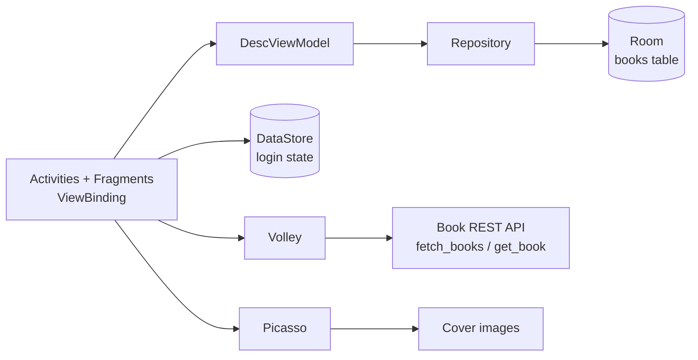

# BookApp

A Kotlin Android app for browsing books from a REST API and saving favourites offline with Room.


## 📖 About

BookApp shows a catalogue of books fetched from a web API, opens a detail page for each one, and lets you keep favourites in a local database. I built it to practise modern Android building blocks in Kotlin: Room for persistence, Preferences DataStore for session state, a ViewModel and repository layer, coroutines, and Volley for networking.

## ✨ Features

- **Login screen** that stores the logged-in state in Preferences DataStore, so a returning user skips straight to the dashboard (`LoginActivity`, `DataStoreInstance`)
- **Dashboard** that fetches the book list with a Volley `JsonObjectRequest` and renders cards with name, author, price, rating and cover in a `RecyclerView` (`DashboardFragment`, `DashboardRecyclerAdapter`)
- **Cover images** loaded with Picasso, with a default cover when an image fails
- **Book details** screen that POSTs the book id to the API and shows the full description, price and rating (`DescriptionActivity`)
- **Add to and remove from favourites**, stored as `BookEntity` rows in Room through `DescViewModel` and `Repository`, with the button label and colour reflecting the current state
- **Offline handling**: a connectivity check before every request, with a dialog to open wireless settings or exit (`ConnectionManager`)
- **Navigation drawer** with Dashboard, Favourites, Profile, About App and Logout. Back from any section returns to the dashboard (`MainActivity`)
- Favourites, Profile and About screens are laid out as UI (`FavouritesFragment`, `ProfileFragment`, `AboutAppFragment`)

## 🧰 Tech stack

| Area | Tools |
| --- | --- |
| Language | Kotlin 1.9 |
| Android | compileSdk 33, minSdk 24, ViewBinding, Material Components, DrawerLayout, CardView |
| Architecture | ViewModel, LiveData, repository pattern, Kotlin coroutines |
| Persistence | Room 2.5 (with KSP), Preferences DataStore |
| Networking | Volley |
| Images | Picasso, CircleImageView |
| Build | Gradle Kotlin DSL |

## 🏗️ Architecture



The dashboard and detail screens call the book API with Volley and map the JSON into `Book` models for display. When you favourite a book, the detail screen hands a `BookEntity` to `DescViewModel`, which runs the Room insert or delete on `Dispatchers.IO` through the `Repository`. Login state lives in DataStore and is read as a `Flow` when the app starts.

```
BookApp/app/src/main/java/com/example/bookapp/
├── activity/      # LoginActivity, MainActivity, DescriptionActivity
├── fragment/      # Dashboard, Favourites, Profile, AboutApp
├── adapter/       # DashboardRecyclerAdapter
├── viewModel/     # DescViewModel (+ factory)
├── repository/    # Repository over BookDao
├── database/      # BookEntity, BookDao, BookDatabase (Room)
├── dataStore/     # DataStoreInstance (login state)
├── model/         # Book
└── util/          # ConnectionManager
```

## 🚀 Getting started

Prerequisites: Android Studio (Giraffe or newer) with JDK 17 and a device or emulator on API 24+.

1. Clone the repo and open the `BookApp` folder in Android Studio.
2. Point the app at a book API that returns `{ success, data: [{ book_id, name, author, rating, price, image }] }` for the list and `{ success, book_data: { ... description } }` for a single book. Set your own endpoint URLs and API token in `DashboardFragment.kt` and `DescriptionActivity.kt`, and keep the token out of version control (for example in `local.properties` exposed through `BuildConfig`).
3. Set your own demo login values in `LoginActivity.kt`.
4. Sync Gradle and run the `app` configuration.

## 💡 What I learned

- Defining a Room entity, DAO and singleton database, and exposing a query as a `Flow` that becomes `LiveData` in the ViewModel.
- Running database writes off the main thread with `viewModelScope.launch(Dispatchers.IO)`. Room rejects main-thread queries, so the favourite check in `DescriptionActivity` should move into a coroutine too.
- Persisting a session flag with Preferences DataStore instead of SharedPreferences.
- Custom Volley requests with extra headers, plus a graceful no-network path.

## 📌 Status

Built in 2024. Not actively maintained, and dependencies may need updating.

---

Built by Naman Chawla · [LinkedIn](https://www.linkedin.com/in/naman-chawla-63529b21b)
